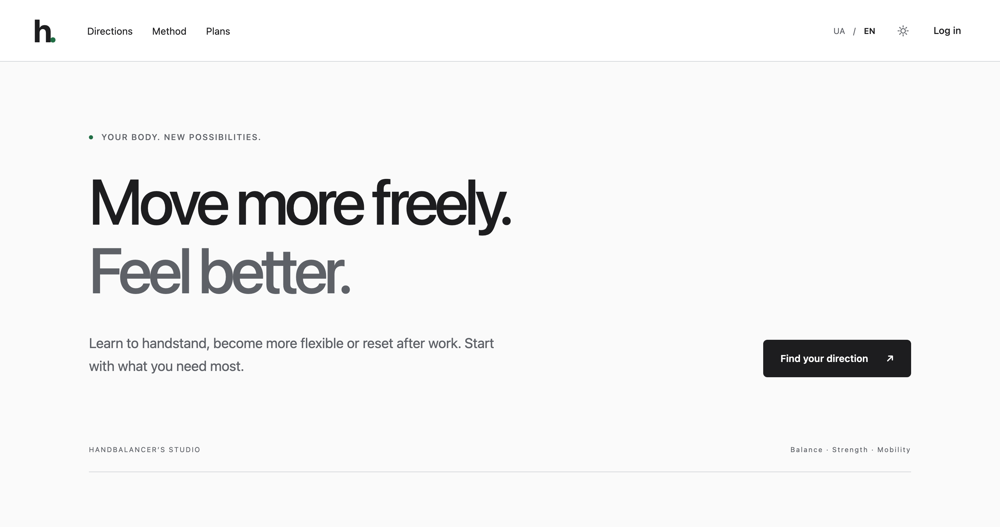

<picture>
  <source media="(prefers-color-scheme: dark)" srcset="assets/wordmark-dark.svg">
  
</picture>

<strong>Full-stack development &amp; product engineering</strong>

Tralee, Ireland · Open to remote opportunities

<a href="https://www.linkedin.com/in/ivan-zamurenko/">LinkedIn</a> &nbsp; / &nbsp; <a href="#selected-work">Selected work</a>

I build web applications and tools for work that still involves too many manual steps. My projects range from logistics automation to software for handstand training. I work across Python, JavaScript, TypeScript and SQL, with an interest in both the interface and the decisions behind it.

Below are three projects that show different parts of that work: handling uncertain outcomes, building an application from its foundations, and turning structured data into something useful.

## Selected work

### 01 / Logistics workflow automation

**JavaScript · Chrome Manifest V3 · Node.js**

EXTENSION INTERFACE · IDLE STATE · RENDERED LOCALLY

A Chrome extension and supporting tools for parcel-processing workflows. The project brings together barcode scanning, browser interactions and service integrations to reduce repetitive steps in handling shipments.

The interesting engineering problem is what happens when an action does not finish cleanly. An interrupted request can leave a write's outcome uncertain; immediately trying again may repeat an action. The repository includes tests for bounded retries, cancellation and uncertain writes. Those cases are a useful window into how the project handles failure.

The code has evolved beyond its original Gmail-focused name. AI-assisted features remain planned work.

[Explore the repository →](https://github.com/ivan-zamurenko/gmail-ai-assistant)

---

### 02 / Handbalancer’s Studio

**Python · FastAPI · PostgreSQL · Jinja · JavaScript**

HANDBALANCER’S STUDIO · CURRENT BUILD · SOURCE PRIVATE

A web application I'm building for handstand training. The aim is to bring programmes, practice and coaching into one place. The current work establishes the foundation: public pages, account flows, and a responsive interface in Ukrainian and English, with light and dark themes.

The application uses a Python backend, PostgreSQL and server-rendered pages with vanilla JavaScript. That gives me one project in which to work on database changes, backend behaviour and the details someone actually sees: navigation on a small screen, form feedback and loading states.

Recent work has focused on mobile navigation and account screens. Training workflows and subscriptions are planned features, and some authentication checks still depend on the external environment. The application is in development; its source code is private. The screenshot above shows the current public-facing homepage, captured locally.

---

### 03 / Handstand programme generator

**Python · ReportLab**

PROGRAMME GENERATOR · EXAMPLE PDF COVER

A command-line tool that turns exercise definitions and programme templates into a training PDF. It connects structured exercise data with a document that can be read away from the application.

The repository contains the generator, an example PDF and unit tests. It is a smaller project than Studio, with a clear input and output, and offers a straightforward way to inspect the Python code alongside what it produces.

[Explore the repository →](https://github.com/ivan-zamurenko/handstand-course-generator)

## Working with data

SQL and data analysis are also part of my background. My [food delivery analysis project](https://github.com/ivan-zamurenko/Delivery-Food-Center-in-Brazil) includes Python data processing and PostgreSQL work. It complements the application projects with examples of querying, transforming and checking data.

## Let's talk

I'm looking for a remote **Full-stack or Product Engineer** role with a team hiring in Ireland. If these projects are relevant to what you're building, I'd be glad to talk through the code and the decisions behind it.

[Get in touch on LinkedIn →](https://www.linkedin.com/in/ivan-zamurenko/)
