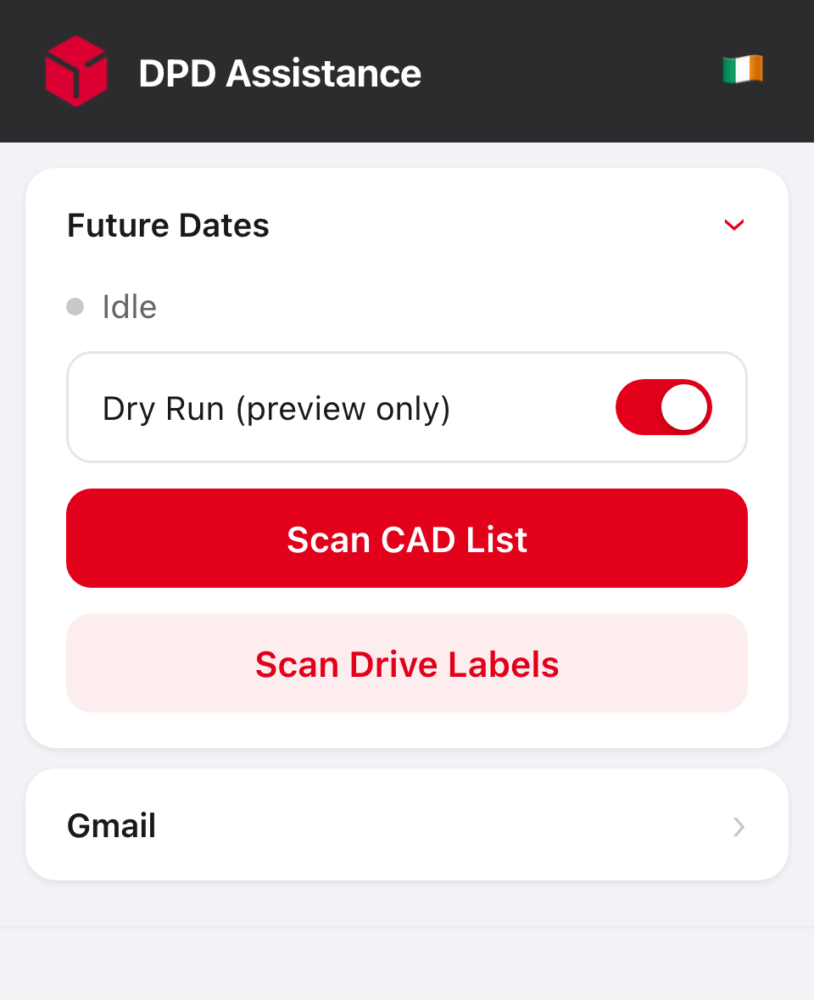
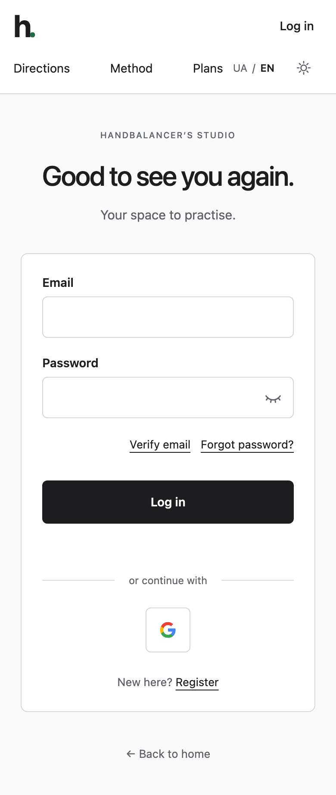
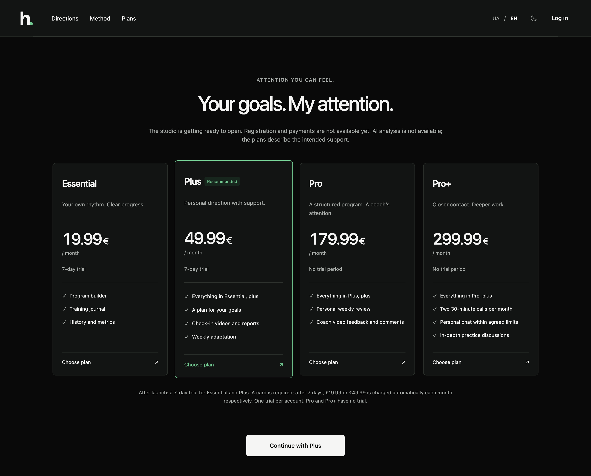
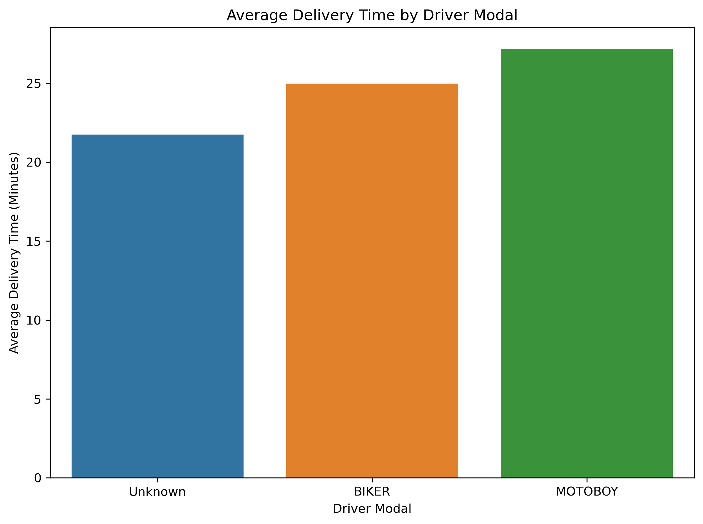
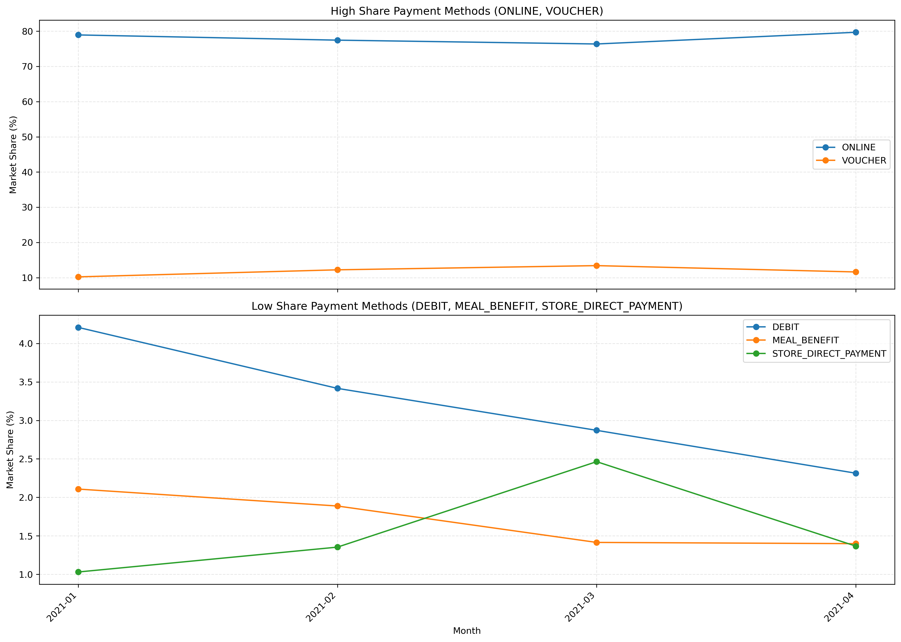

<!doctype html><html lang="en"><head><meta charset="utf-8"><meta name="viewport" content="width=device-width,initial-scale=1"><title>Ivan Zamurenko — GitHub profile preview</title></head><body>
LOCAL PREVIEW · GitHub-rendered Markdown with approximate GitHub styling · Unpublished
<article class="markdown-body"><themed-picture data-catalyst-inline="true"><picture>
  <source media="(prefers-color-scheme: dark)" srcset="assets/wordmark-dark.svg">
  
</picture></themed-picture>

<strong>Full-stack development &amp; product engineering</strong>

Tralee, Ireland · Open to remote opportunities

<a href="https://www.linkedin.com/in/ivan-zamurenko/" rel="nofollow">LinkedIn</a>

  <a href="#dpd-assistance"> DPD Assistance</a>   ·  
  <a href="#handbalancers-studio"> Handbalancer’s Studio</a>   ·  
  <a href="#food-delivery-analytics"> Food Delivery Analytics</a>

I build web applications and tools for work that still involves too many manual steps. My projects cover logistics automation, software for handstand training and operational data analysis. I work across Python, JavaScript, TypeScript and SQL, with an interest in both the interface and the decisions behind it.

Below are three projects that show different parts of that work: handling uncertain outcomes, building an application from its foundations, and turning structured data into something useful.

<h3 id="dpd-assistance" dir="auto"> DPD Assistance</h3>

  
  
  

EXTENSION INTERFACE · IDLE STATE · RENDERED LOCALLY

Recovery &amp; redelivery — navigation report

RECOVERY REPORT · LOCAL PREVIEW · SYNTHETIC DATA

A Chrome extension and supporting tools for parcel-processing workflows. The project brings together barcode scanning, browser interactions and service integrations to reduce repetitive steps in handling shipments.

The interesting engineering problem is what happens when an action does not finish cleanly. An interrupted request can leave a write's outcome uncertain; immediately trying again may repeat an action. The repository includes tests for bounded retries, cancellation and uncertain writes. Those cases are a useful window into how the project handles failure.

For a parcel left in the wrong place, the bot's <code class="notranslate">/report</code> flow can provide two driving-navigation links: one to the selected delivery event's GPS point, when available, and another to the destination Eircode. Each opens navigation from the driver's current location. The example above uses synthetic data and the project's report formatter; it shows the report output, not a live map or an optimised multi-stop route.

The code has evolved beyond its original Gmail-focused name. AI-assisted features remain planned work.

<a href="https://github.com/ivan-zamurenko/gmail-ai-assistant">Explore the repository →</a>

<h3 id="handbalancers-studio" dir="auto"> Handbalancer’s Studio</h3>

  
  
  
  
  

HANDBALANCER’S STUDIO · CURRENT BUILD · SOURCE PRIVATE

View 2 more screens — mobile sign-in &amp; dark plans

MOBILE SIGN-IN · LOCAL CAPTURE · EMPTY FORM

DARK THEME · PLANS INTERFACE · PAYMENTS NOT LIVE

A web application I'm building for handstand training. The aim is to bring programmes, practice and coaching into one place. The current work establishes the foundation: public pages, account flows, and a responsive interface in Ukrainian and English, with light and dark themes.

The application uses a Python backend, PostgreSQL and server-rendered pages with vanilla JavaScript. That gives me one project in which to work on database changes, backend behaviour and the details someone actually sees: navigation on a small screen, form feedback and loading states.

Recent work has focused on mobile navigation and account screens. Training workflows and subscriptions are planned features, and some authentication checks still depend on the external environment. The application is in development; its source code is private. The screenshots show the current homepage, mobile sign-in and dark-theme plans interface, captured locally. The plans describe intended support; payments are not live.

<h3 id="food-delivery-analytics" dir="auto"> Food Delivery Analytics</h3>

  
  
  
  

FOOD DELIVERY ANALYTICS · EXPORTED ANALYSIS RESULT

View 2 more charts — hub comparison &amp; payment trends

HUB COMPARISON · EXPORTED DATASET ANALYSIS

PAYMENT-METHOD TRENDS · EXPORTED DATASET ANALYSIS

A Python and PostgreSQL project that brings together delivery, order and payment data from a Brazilian food-delivery dataset. It calculates grouped metrics and produces reports and charts that can be inspected alongside the analysis code.

The work covers data cleaning, relational queries and calculations around delivery performance and payments. The repository includes calculation tests and data-quality checks. This complements my application work with examples of transforming data, checking assumptions and making results understandable.

The gallery contains existing outputs from the repository: delivery times, hub comparisons and payment-method trends. These are static dataset analyses, not live dashboards or claims of operational improvement.

<a href="https://github.com/ivan-zamurenko/Delivery-Food-Center-in-Brazil">Explore the repository →</a>

<h2 dir="auto">Let's talk</h2>

I'm looking for a remote <strong>Full-stack or Product Engineer</strong> role with a team hiring in Ireland. If these projects are relevant to what you're building, I'd be glad to talk through the code and the decisions behind it.

<a href="https://www.linkedin.com/in/ivan-zamurenko/" rel="nofollow">Get in touch on LinkedIn →</a>
</article></body></html>
